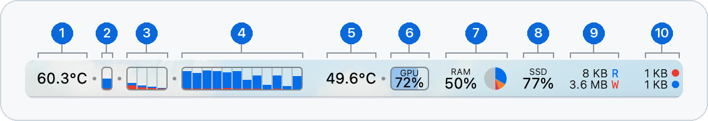
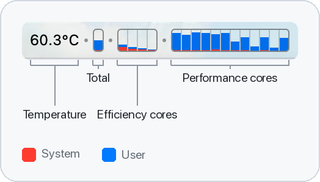
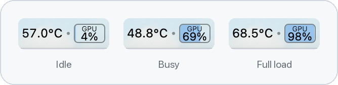
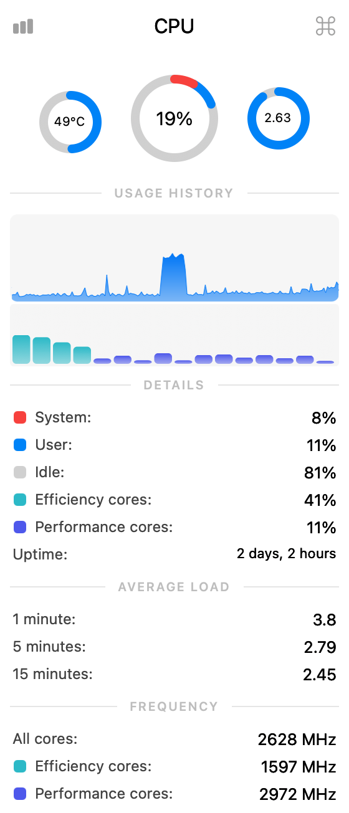
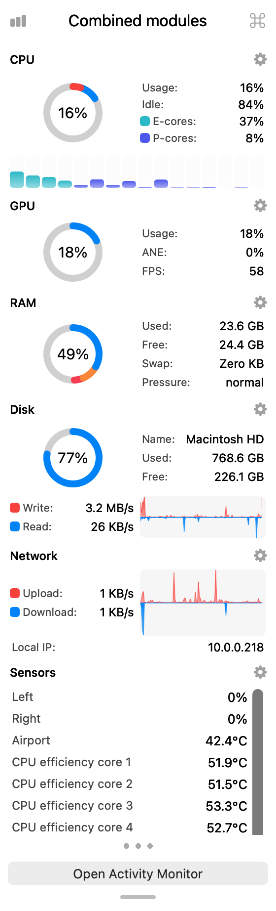

# Gaugebar

A macOS system monitor for your menu bar, with a per-core CPU meter and a GPU gauge you can read at a glance.

Gaugebar is a fork of [Stats](https://github.com/exelban/stats) by Serhiy Mytrovtsiy. It keeps the full monitor: CPU, GPU, memory, disk, network, battery, sensors, Bluetooth and clocks. The meters take their look from [MenuMeters](https://github.com/yujitach/MenuMeters).

<p align="center">
  
</p>

| | What it shows |
|---|---|
| **1** | CPU temperature, to one decimal |
| **2** | Total CPU usage |
| **3** | Efficiency cores, one box per core |
| **4** | Performance cores, one box per core |
| **5** | GPU temperature, the average of the GPU's own sensors |
| **6** | GPU usage. The box is the gauge: it fills from left to right behind the number |
| **7** | Memory used, with a pie of app, wired and compressed memory |
| **8** | Space used on the startup disk |
| **9** | Disk read (**R**) and write (**W**) speed |
| **10** | Network upload (red dot) and download (blue dot) speed |

All screenshots are real captures from a MacBook Pro with an M3 Max, which has 4 efficiency cores and 12 performance cores.

## Download

Get **Gaugebar-1.0.0.zip** from the [latest release](https://github.com/grandleaf/Gaugebar/releases/latest). It needs macOS 12 or later and runs natively on Apple silicon and Intel Macs.

1. Unzip it and move **Gaugebar.app** to your Applications folder.
2. Open Gaugebar. macOS says it can't verify the app, because this build isn't notarized by Apple. Click **Done**.
3. Open **System Settings → Privacy & Security**, scroll down, and click **Open Anyway** next to the message about Gaugebar. Confirm, then click **Open**.

You only need to do this once. On macOS 14 or earlier, you can instead Control-click the app, choose **Open**, and click **Open** again.

Gaugebar doesn't update itself. To hear about new versions, choose **Watch → Custom → Releases** on this repository.

## CPU: one box per core

<p align="center">
  
</p>

Every core gets its own outlined box, so each one stays identifiable even at 0%.

- **Core groups:** efficiency cores come first, then performance cores, the same order macOS numbers them in. Each group sits in one rounded outline, and a small dot separates the groups.
- **Total:** the narrow box on the left shows usage across all cores.
- **System and user:** each box fills from the bottom, red for system load under blue for user load.
- **Temperature:** the CPU temperature sits on the left, followed by a dot that ties it to the meter. It uses the unit from the **Temperature** app setting, and hides if the Mac reports no CPU temperature.
- **Fits any Mac:** on Macs with many cores, boxes shrink to fit the maximum width, down to 3 points wide.

The CPU bar chart with per-core usage is the default widget. Open the settings for that widget to change:

| Setting | Default |
|---|---|
| Separate core boxes | On |
| Stack system and user | On. Turn it off to use the widget's **Color** option instead |
| Temperature | On |
| Box width | 9 pt |
| Box gap | 0 pt. Above zero, boxes stand apart with their own square outlines |
| Cluster gap | 11 pt, added to the box gap |
| Maximum width | 300 pt |

The boxes are 19 points tall, and the defaults take about 141 points for 16 cores. The **Cluster** color keeps cluster coloring, using a darker shade for system load.

## GPU: the box is the gauge

<p align="center">
  
</p>

The **Gauge** widget shows the GPU usage number on top of a pale level, so you can read the value and see the level in one place. The level fills from left to right inside a rounded outline, at the same height as the CPU boxes.

The GPU temperature sits on its left with a dot, just like the CPU temperature. It's the average of the GPU's own temperature sensors, 8 of them on an M3 Max. Turn it off with the **Temperature** switch in the Gauge widget's settings.

The GPU bar chart widget uses the same outlined box as the CPU meter, without the per-core settings.

## Panels

<table>
  <tr>
    <td align="center" valign="top"><br><b>Left click</b>: just the module you clicked</td>
    <td align="center" valign="top"><br><b>Right click</b>: every module in one panel</td>
  </tr>
</table>

With **Combined modules** on, all meters share one menu bar item with even gaps between them.

- **Left click** opens only the module you clicked, right below it.
- **Right click** opens the whole panel, with Sensors last and an **Open Activity Monitor** button at the bottom.
- **Resize:** drag the grip at the bottom of the whole panel to give Sensors more room. The height is remembered, and the panel always fits the screen it opens on.
- Turn **Combined details** on to swap the two clicks.

## Other changes from Stats

### Short speed labels
The Network and Disk speed widgets show `B`, `KB` and `MB` without `/s` to save menu bar space. Panels keep `KB/s`.

### Runs alongside Stats
Gaugebar has its own name, icon, bundle IDs, app group and data folder, so it shares no settings or history with an installed Stats.

### No dependency on the Stats author's services
- **Updates:** the updater is removed. Gaugebar doesn't check for updates.
- **System Stats account:** the Remote module and account are removed.
- **Support prompts:** the support window, donation links and bug report link are removed.
- **Public IP:** off by default. If you turn it on, Gaugebar asks `api.ipify.org`, and the country flag is no longer shown.
- **Network connectivity check:** unchanged from Stats. While the Network module is on, it pings `1.1.1.1`. You can change the host or switch to an HTTP check of `google.com` in the Network settings.

### No privileged helper
`SMCHelper` and manual fan control are removed, so Gaugebar never asks for an administrator password. It only reads from the SMC and contains no code that writes to it, and `make test-smc` fails if that ever changes. macOS manages the fans as usual, and sensor readings and fan speeds still work.

## Build

To build Gaugebar yourself, you need macOS 12 or newer, Xcode, and an Apple Development signing identity.

1. Create your local signing config:

   ```bash
   cp Config/Local.example.xcconfig Config/Local.xcconfig
   ```

2. Set `DEVELOPMENT_TEAM` in `Config/Local.xcconfig` to your team ID. This prints it as the `OU=` value:

   ```bash
   security find-certificate -c "Apple Development" -p | openssl x509 -noout -subject
   ```

3. Build and open the app:

   ```bash
   make run
   ```

The app is at `build/DerivedData/Build/Products/Release/Gaugebar.app`. Copy it to `/Applications` to keep it.

### Default settings
A fresh install starts with the settings in `Stats/Supporting Files/DefaultSettings.plist` and skips the first-run setup. Settings saved on a Mac always win over this file.

To make your current settings the defaults, run this and rebuild:

```bash
make save-defaults
```

Window positions, login state and individual sensor choices stay out of the file because they belong to one Mac.

Run the tests with `make test`.

Builds signed this way are for your own Mac. Distributing a notarized build needs a Developer ID.

The project, targets and folders still use the name `Stats`, and the Xcode scheme is `Stats`. That keeps upstream changes easy to merge.

## Following Stats

Gaugebar has its own version numbers. Version 1.0.0 is based on Stats 3.0.23.

Gaugebar tracks [Stats](https://github.com/exelban/stats), so check it now and then for fixes and features worth bringing over. Its [releases page](https://github.com/exelban/stats/releases) has the change notes.

This shows what Stats has changed since Gaugebar last merged it:

```bash
make upstream
```

To bring over one change, use the commit shown in that list:

```bash
git cherry-pick <commit>
```

To take a whole release:

```bash
git merge v3.0.24
```

Expect conflicts where Gaugebar removed code that Stats still changes, mainly the Remote module, the updater and fan control. Before keeping a change, check that it doesn't add a dependency on the Stats author's servers or a privileged helper.

## Credits and license

Gaugebar is based on [Stats](https://github.com/exelban/stats), copyright © 2019 Serhiy Mytrovtsiy, used under the MIT License. It is released under the same license. See [LICENSE](LICENSE).

The per-core look is inspired by [MenuMeters](https://github.com/yujitach/MenuMeters). No MenuMeters code is used.
