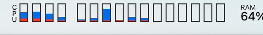

# Gaugebar

A macOS system monitor for your menu bar, with a per-core CPU meter you can read at a glance.

Gaugebar is a fork of [Stats](https://github.com/exelban/stats) by Serhiy Mytrovtsiy. It keeps the full monitor: CPU, GPU, memory, disk, network, battery, sensors, Bluetooth and clocks.



## What changed from Stats

### Per-core meter
Each core gets its own outlined box, so every core stays identifiable even at 0%.

- Boxes are 19 points tall and fill from the bottom, with system load under user load.
- Efficiency cores come first, then performance cores, with a larger gap between clusters.
- The outline follows the menu bar's appearance, so it matches the menu bar text.
- On Macs with many cores, boxes shrink to fit the maximum width, down to 3 points wide with 1 point gaps.

The CPU bar chart with per-core usage is the default widget. Open the settings for that widget to change:

| Setting | Default |
|---|---|
| Separate core boxes | On |
| Stack system and user | On. Turn it off to use the widget's **Color** option instead |
| Box width | 9 pt |
| Box gap | 4 pt |
| Cluster gap | 7 pt, added to the box gap |
| Maximum width | 300 pt |

The defaults take about 211 points for 16 cores. If that is too much menu bar space, 6 pt boxes with 3 pt gaps take about 148 points.

The **Cluster** color keeps cluster coloring, using a darker shade for system load.

### Runs alongside Stats
Gaugebar has its own name, icon, bundle IDs, app group and data folder, so it shares no settings or history with an installed Stats.

### No dependency on the Stats author's services
- **Updates:** the updater is removed. Gaugebar doesn't check for updates.
- **System Stats account:** the Remote module and account are removed.
- **Support prompts:** the support window, donation links and bug report link are removed.
- **Public IP:** off by default. If you turn it on, Gaugebar asks `api.ipify.org`, and the country flag is no longer shown.
- **Network connectivity check:** unchanged from Stats. While the Network module is on, it pings `1.1.1.1`. You can change the host or switch to an HTTP check of `google.com` in the Network settings.

### No privileged helper
`SMCHelper` and manual fan control are removed, so Gaugebar never asks for an administrator password. macOS manages the fans as usual. Sensor readings and fan speeds still work, because they don't need the helper.

## Build

You need macOS 12 or newer, Xcode, and an Apple Development signing identity.

1. Create your local signing config:

   ```bash
   cp Config/Local.example.xcconfig Config/Local.xcconfig
   ```

2. Set `DEVELOPMENT_TEAM` in `Config/Local.xcconfig` to your team ID. This prints it as the `OU=` value:

   ```bash
   security find-certificate -c "Apple Development" -p | openssl x509 -noout -subject
   ```

3. Build and open the app:

   ```bash
   make run
   ```

The app is at `build/DerivedData/Build/Products/Release/Gaugebar.app`. Copy it to `/Applications` to keep it.

Run the tests with `make test`.

Builds signed this way are for your own Mac. Distributing a notarized build needs a Developer ID.

The project, targets and folders still use the name `Stats`, and the Xcode scheme is `Stats`. That keeps upstream changes easy to merge.

## Merging upstream changes

```bash
git remote add upstream https://github.com/exelban/stats.git
git fetch upstream --tags
git merge v3.0.24
```

Expect conflicts where Gaugebar removed code that upstream still changes, mainly the Remote module, the updater and fan control.

## Credits and license

Gaugebar is based on [Stats](https://github.com/exelban/stats), copyright © 2019 Serhiy Mytrovtsiy, used under the MIT License. It is released under the same license. See [LICENSE](LICENSE).

The per-core look is inspired by [MenuMeters](https://github.com/yujitach/MenuMeters). No MenuMeters code is used.
